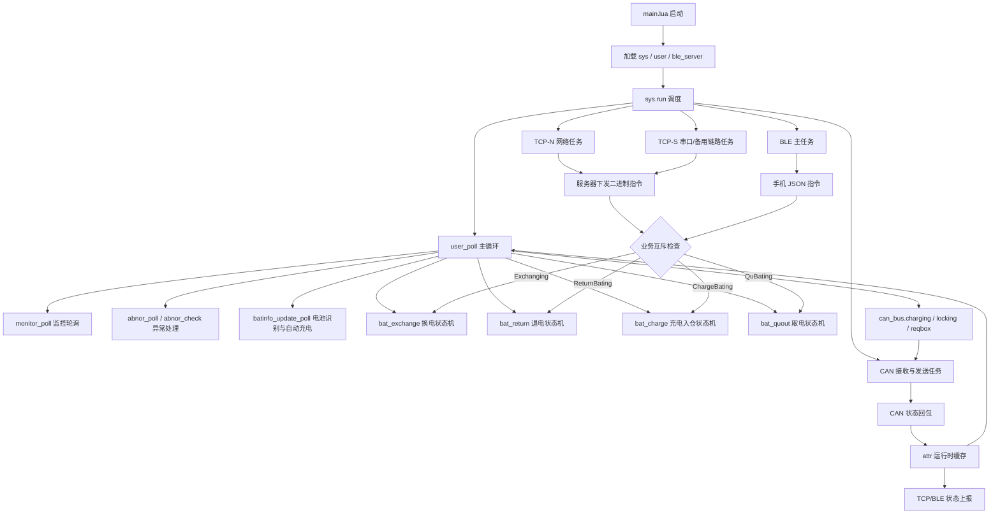
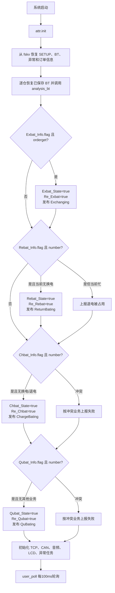
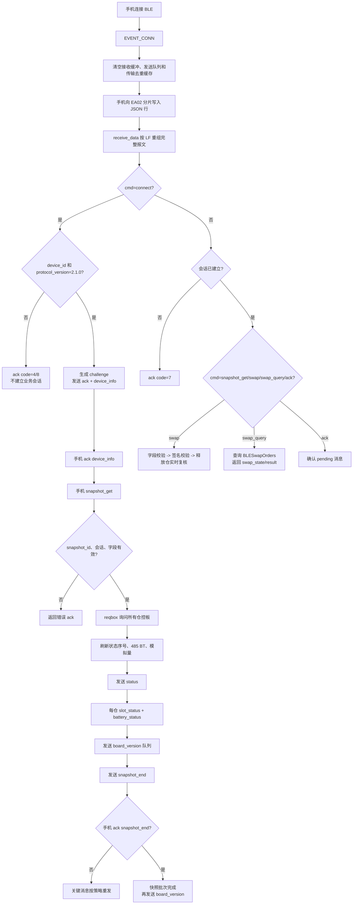
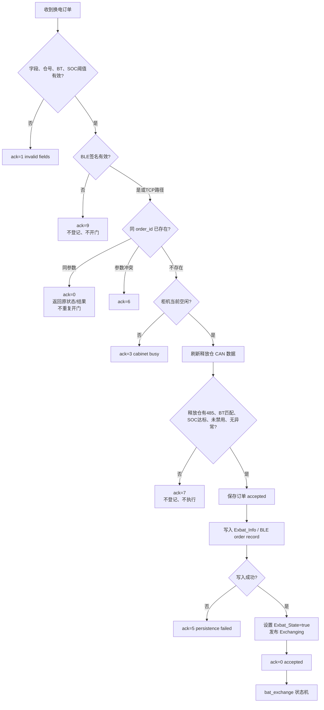
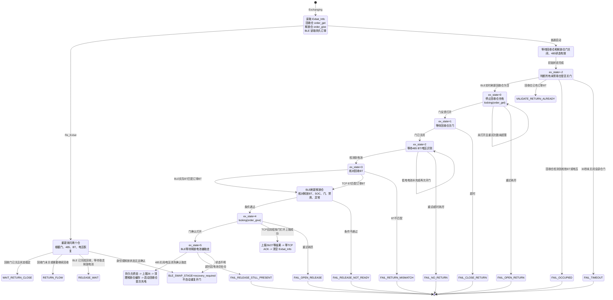
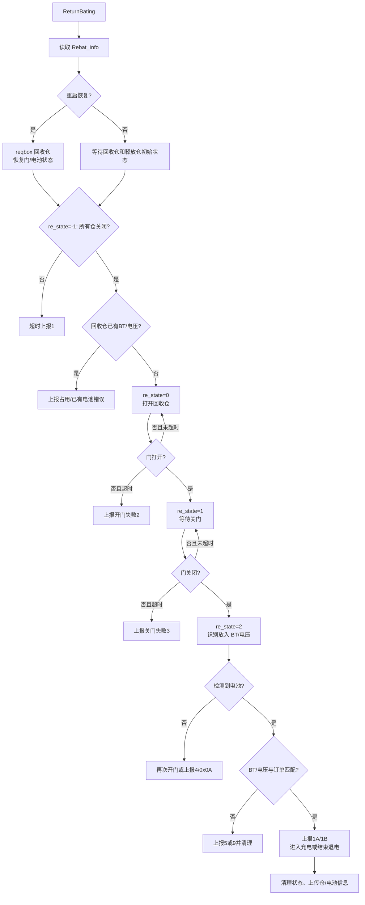
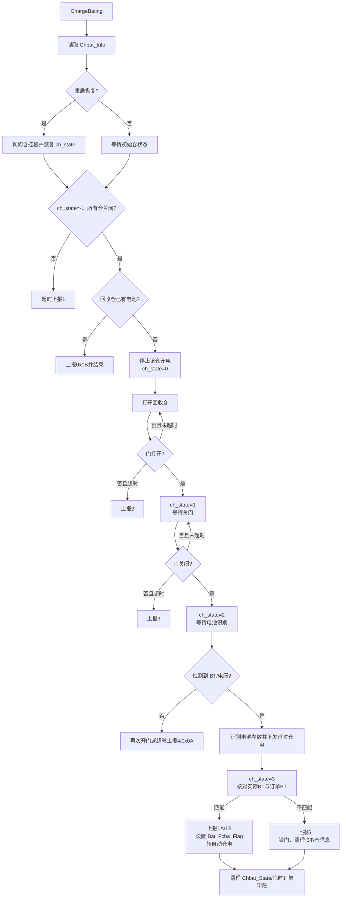
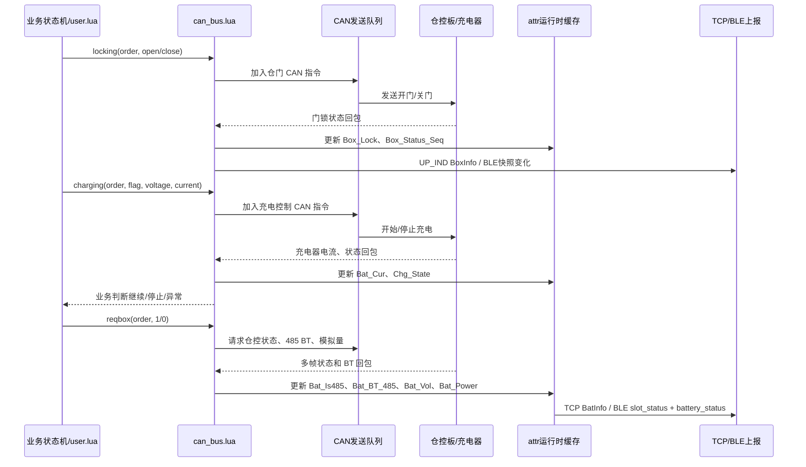
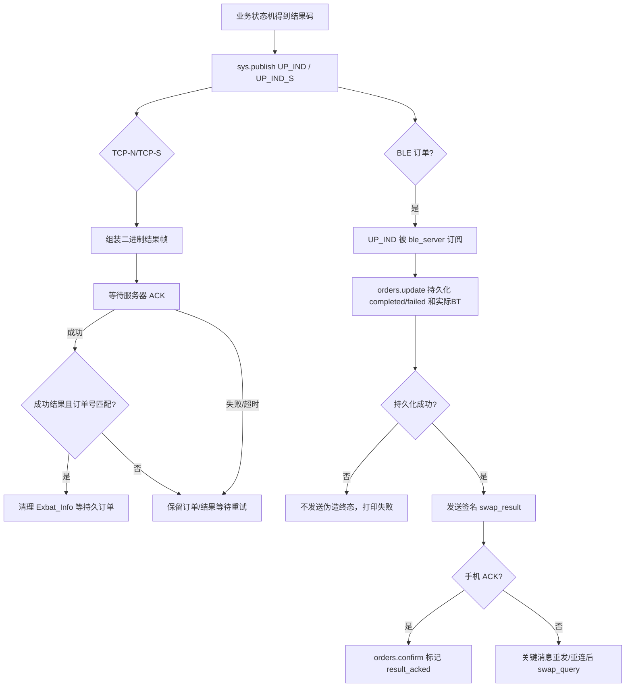

# H 换电柜业务流程图

本文档根据当前工程代码整理，入口为 `main.lua`。图中的“上报”表示通过 TCP 或 TCP-S 发送到服务器；BLE 流程使用 `ble_server.lua` 的 JSON 协议；仓门、充电器和仓控板动作最终都通过 `can_bus.lua` 下发 CAN。

## 1. 系统总览



**核心代码：** `main.lua`；`user/user.lua:user_poll`、`user_init`；`user/can_bus.lua:rece_process/send_process`。

## 2. 启动、初始化和断电恢复



订单的持久信息：

- TCP 旧业务：`Exbat_Info`、`Rebat_Info`、`Chbat_Info`、`Qubat_Info`，使用 `attr.*_info_set` 写入 `fskv`。
- BLE JSON 业务：`BLESwapOrders` 索引和逐笔记录，保存订单参数、阶段、结果和实际 BT 码，供重连查询和防重复开门。

**源码：** `user/user.lua:user_init`；`user/attr.lua:attr.init`、`attr.exbat_info_set`；`user/ble_swap_orders.lua`。

## 3. TCP 指令接入和业务分发

```mermaid
flowchart TD
    A[TCP 收到完整帧] --> B[class_process / recv_process]
    B --> C{帧类型}
    C -->|0x06 ExchangeBat| D[解析回收仓、回收BT、释放仓、释放BT、订单号、锁标志]
    C -->|0x20 ReturnBat| E[解析退电订单]
    C -->|0x27 ChargeBat| F[解析充电入仓仓号、BT、订单号]
    C -->|0x2A QuBat| G[解析取电订单]
    C -->|0x0E Charging| H[解析人工充电开关、电压、电流]
    C -->|0x19 Delete| I[清除仓信息]
    C -->|其他控制类| J[开门、禁仓、风扇、升级、报警等]

    D --> D1{仓号/BT/长度有效?}
    D1 -->|否| D2[拒绝并上报错误]
    D1 -->|是| X{Exbat/Rebat/Chbat/Qubat/升级状态?}
    X -->|忙| X1[返回重复、占用或冲突结果]
    X -->|空闲| X2[attr.exbat_info_set(true, ...)<br/>写 Exbat_Info]
    X2 --> X3[发布 Exchanging]

    E --> E1{空闲且参数有效?}
    E1 -->|是| E2[保存 Rebat_Info<br/>发布 ReturnBating]
    E1 -->|否| E3[返回冲突/参数错误]
    F --> F1{业务空闲且仓号/BT有效?}
    F1 -->|是| F2[保存 Chbat_Info<br/>发布 ChargeBating]
    F1 -->|否| F3[返回冲突/参数错误]
    G --> G1{业务空闲且仓号有效?}
    G1 -->|是| G2[保存 Qubat_Info<br/>发布 QuBating]
    G1 -->|否| G3[返回冲突/参数错误]
    H --> H1[can_bus.charging 开启或关闭<br/>更新 C_Chg 位图]
    I --> I1[attr.bat_clean<br/>清理本仓 BT、SOC、电压等缓存]
```

`0x19 Delete` 是“清除仓信息”，不是普通状态读取。执行后 `attr.bat_BT_get(order)` 为空，之后 `batinfo_upload` 会用 `FF` 填充 BT 字段。

**源码：** `user/tcp_net.lua:class_process`、`user/tcp_net.lua` 的 `CLASS.ExchangeBat/ChargeBat/Delete` 分支；`user/tcp_s.lua` 有对应的 TCP-S 分支。

## 4. BLE JSON 接入、握手和快照



快照仓位数据来源：

```mermaid
flowchart LR
    A[CAN reqbox(slot,1)] --> B[仓控状态回包]
    B --> C[门锁、485在线、仓电压、仓温度]
    A --> D[485 BT 分片回包]
    D --> E[Bat_BT_485]
    A --> F[模拟量/电池电压/SOC回包]
    F --> G[Bat_Vol、Bat_Cur、Bat_Power]
    C --> H[slot_status]
    E --> I[battery_status.bt_code]
    G --> I
    J[持久 bat_BT_get] -.仅诊断/历史绑定.-> I
    I --> K{当前采样有效?}
    K -->|是| L[发送实时值]
    K -->|否| M[发送 JSON null]
```

**源码：** `user/ble_server.lua:receive_data`、`handle_message`、`snapshot`、`refresh_snapshot_slots`；`user/ble_swap_orders.lua:refresh_release/refresh_return`。

## 5. BLE/TCP 换电受理和执行



## 6. 换电状态机 `bat_exchange`



关键动作：

- `ex_state=-2`：先确保所有相关仓门关闭，再用 BLE 新鲜采样判断回收仓是否为空，避免用旧 `bat_BT_get` 误判。
- `ex_state=0`：打开回收仓；门反馈为 `Box_Lock[order_get] == 0` 才算打开。
- `ex_state=1/2`：等待关门并识别放入电池。
- `ex_state=3`：核对回收 BT；BLE 还会在打开释放门前实时复核释放仓身份和 SOC。
- `ex_state=4`：打开释放仓。BLE 在 `ex_state=5` 等待真实取走确认后才完成。

**源码：** `user/user.lua:bat_exchange`，`user/ble_swap_orders.lua:release_ready/refresh_release/refresh_return`。

## 7. 退电流程 `bat_return`



**源码：** `user/user.lua:bat_return`，订单入口为 `user/tcp_net.lua` 的 `CLASS.ReturnBat` 分支。

## 8. 充电入仓流程 `bat_charge`



**源码：** `user/user.lua:bat_charge`；订单入口为 `user/tcp_net.lua:CLASS.ChargeBat`。

## 9. 取电流程 `bat_quout`

```mermaid
flowchart TD
    A[QuBating] --> B[读取 Qubat_Info]
    B --> C{重启恢复?}
    C -->|是| D[询问释放仓<br/>停止充电并等待稳定]
    C -->|否| E[等待仓门关闭、485有效]
    D --> F{仓门已开或电池已不在?}
    E --> F
    F -->|是| G[上报1A<br/>关闭充电、清理仓信息]
    F -->|否| H[qu_state=-1 -> locking(order_give)]
    H --> I{门反馈打开?}
    I -->|是| G
    I -->|否且未超时| H
    I -->|否且超时| J[上报8取电失败]
    G --> K[Qubat_State=false]
    J --> K
```

**源码：** `user/user.lua:bat_quout`；订单入口为 `user/tcp_net.lua` 的 `CLASS.QuBat` 分支。

## 10. 自动充电判断与执行

```mermaid
flowchart TD
    A[batinfo_update_poll 每仓循环] --> B{attr.bat_BT_get(i)?}
    B -->|否| C[不进入该仓自动充电逻辑]
    B -->|是| D[读取电池额定电压/容量、温度、SOC、充电器状态]
    D --> E[计算 cur_1: 系统/电池额定电流上限]
    D --> F{有 Bat_Cha_Flag?}
    F -->|否| G[按温度和 SOC 计算 cur_2]
    F -->|0x55| H[采用电池请求 Bat_Cha_Cur/Bat_Cha_Vol]
    F -->|0xAA| I[cur_2=0，限制充电]
    G --> J
    H --> J
    I --> J
    J[取 min(cur_1,cur_2)，得到 Chg_Cur/Chg_Vol] --> K{禁充条件?}
    K -->|是| K1[Forb_Chg=true<br/>停止计数]
    K -->|否| L{换电/退电/充电入仓/取电/升级进行中?}
    L -->|是| L1[不自动启动]
    L -->|否| M{仓门关闭且允许充电?}
    M -->|否| N[清零充电计数]
    M -->|是| O{未充满、无充电或电流异常?}
    O -->|是| P[chg_cnt累计]
    O -->|否| Q[计数清零]
    P --> R{计数超过阈值?}
    R -->|1400| R1[短暂停止/等待]
    R -->|1600| R2[can_bus.charging(true,目标电压,目标电流)]
    R2 --> S[充电器通过 CAN 回报电流/状态]
    S --> T{异常、满电、高温、MOS/AFE/压差?}
    T -->|是| U[can_bus.charging(false,0,0)<br/>上报异常]
    T -->|否| V[继续充电并更新状态]
```

自动充电的最终执行点只有 `can_bus.charging`；电池的 `0x55/0xAA` 充电机制回包在 `can_bus.lua` 中更新限制参数，直接调用充电的代码目前是注释状态。

## 11. CAN 控制和反馈闭环



**CAN 控制入口：** `user/can_bus.lua:can_bus.charging`、`locking`、`reqbox`。

## 12. 结果上报和清理



协议语义上，`ack=0` 只表示受理或收到，不表示换电完成；只有实际状态机完成并持久化终态后，才发送换电结果。

## 13. 代码导航

| 模块 | 主要职责 | 关键入口 |
| --- | --- | --- |
| `main.lua` | 固件启动、加载模块、启动 `sys.run` | `require "user"`, `require "ble_server"` |
| `user/user.lua` | 业务状态机、自动充电、异常监控、恢复 | `user_init`, `user_poll`, `bat_exchange`, `bat_return`, `bat_charge`, `bat_quout` |
| `user/attr.lua` | 运行时缓存和传统 TCP 订单持久化 | `attr.*_info_set`, `attr.bat_clean` |
| `user/can_bus.lua` | CAN 收发、仓门、充电、仓控板询问 | `charging`, `locking`, `reqbox`, `rece_process` |
| `user/tcp_net.lua` | TCP-N 二进制协议、订单接收、结果上传 | `class_process`, `upload_indicate`, `poll_task` |
| `user/tcp_s.lua` | TCP-S/备用链路二进制协议 | `class_process`, `upload_indicate`, `poll_task` |
| `user/ble_server.lua` | BLE JSON 分帧、握手、快照、订单入口和结果 | `receive_data`, `handle_message`, `snapshot`, `handle_swap` |
| `user/ble_swap_orders.lua` | BLE 订单去重、持久化、实时仓况复核 | `admit`, `update`, `confirm`, `refresh_return`, `refresh_release` |

